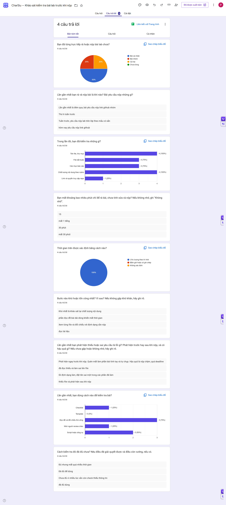

# Báo cáo nhóm — Day 02 Discovery & Problem Framing

> Bản chung của nhóm, viết trên repo do nhóm trưởng fork. Không copy file này sang repo cá nhân.
> Template chi tiết và prompt mẫu: [docs/01-worksheet.md](../../docs/01-worksheet.md). Bài mẫu: [docs/02-deliverable-example.md](../../docs/02-deliverable-example.md).

## 1. Thông tin nhóm

- Tên nhóm: CharSiu
- Thành viên: Đồng Ngọc Phúc (2A202603399), Dương Tuấn Hưng (2A202603416), Nguyễn Tuấn Kiệt (2A202603417), Trần Thị Lý (2A202603404). Phân công và đóng góp từng người cần cập nhật trong `TEAM.md`.
- Candidate problem được chọn (1 câu): Kiểm tra bài nộp theo rubric/quy cách trước deadline (gộp candidate #5 và #7 ở CP3).
- Quyết định cuối: **Not Yet** đối với triển khai/mở rộng tự động; **No AI** (checklist + review chéo) là phương án thử đầu tiên. Nhóm đã đồng ý lựa chọn, mục tiêu rà tối đa 20 phút và quyết định này qua xác nhận của Phúc ngày 09/11/2026.

---

## 2. Hội tụ nhóm (CP3)

### 2.1. Pitch

| # | Người đưa ra | Candidate (Job Story ngắn) | Actor | Bottleneck | Câu hỏi phản biện nhận được (ai hỏi) |
|---:|---|---|---|---|---|
| 1 | [Đồng Ngọc Phúc — Card #1](../individual/2A202603399_DongNgocPhuc.md) | Khi bắt đầu bài lab có nhiều thông tin và yêu cầu, tôi muốn xác định rõ việc cần làm trước và các yêu cầu quan trọng ngay từ đầu, để thực hiện đúng thứ tự và tránh bỏ sót. | Tôi — học viên làm bài lab. | Bottleneck giả định: bước đọc lại để xác định phải làm gì trước, khoảng 5 phút trong lần vừa hồi tưởng. Đọc lượt đầu mất lâu nhất (15 phút), nhưng chưa đủ bằng chứng kết luận đây là bước nghẽn. Khó khăn cốt lõi vẫn là xác định thứ tự và tránh bỏ sót; cần kiểm chứng lại vị trí bottleneck. Tổng lần này khoảng 31 phút. | Nguyễn Tuấn Kiệt hỏi: Nếu dùng checklist theo thứ tự, khó khăn nào vẫn còn khiến bạn chưa biết bắt đầu từ đâu? |
| 2 | [Đồng Ngọc Phúc — Card #2](../individual/2A202603399_DongNgocPhuc.md) | Khi nhóm cần họp làm bài lab, tôi muốn tìm được khung giờ phù hợp cho cả 4 thành viên, để kịp trao đổi và phân công công việc. | Tôi và 3 thành viên trong nhóm làm bài lab. | Chờ đủ phản hồi: khoảng 1 ngày (1.440 phút thời gian trôi qua). Các bước nhắn hỏi, đối chiếu và chốt giờ cộng lại khoảng 8 phút. Tổng quy trình khoảng 1 ngày 8 phút; đây là ước lượng, không phải thời gian làm việc liên tục. | Trần Thị Lý hỏi: Nếu nghẽn chủ yếu ở chờ phản hồi, công cụ đối chiếu lịch giúp được gì khi thành viên chưa trả lời?|
| 3 | [Đồng Ngọc Phúc — Card #3](../individual/2A202603399_DongNgocPhuc.md) | Khi chuẩn bị đi học, tôi muốn mang đủ điện thoại, ví và thẻ xe trước khi rời nhà, để đến lớp đúng giờ. | Tôi — người đi học. | Quay về lấy đồ và đi trở lại vị trí cũ, tổng khoảng 5 phút/lần. Chưa tách thời gian hai chặng; chỉ tính 5 phút một lần. Chưa xác định nguyên nhân quên. | Dương Tuấn Hưng hỏi: Bạn đã thử kiểm tra ba món trước khi rời nhà chưa, và nếu đã thử thì vì sao vẫn quên?|
| 4 | [Dương Tuấn Hưng — Card #1](../individual/2A202603416_DuongTuanHung.md) | Khi kết thúc buổi họp nhóm online, tôi muốn tổng hợp lại các quyết định và danh sách công việc cụ thể kèm người phụ trách, để gửi vào nhóm chat trước khi các thành viên quên hoặc làm lệch hướng. | Thư ký hoặc thành viên chịu trách nhiệm ghi biên bản họp trong nhóm sinh viên làm đồ án | Bước 3: Phải rà soát lại ghi chú hoặc tua lại file ghi âm để xác định chính xác ai nhận task gì và hạn chót khi nào, mất 25–30 phút | Đồng Ngọc Phúc hỏi: Vì sao nhóm chưa chốt người phụ trách và deadline ngay trong lúc họp, thay vì phải nghe lại sau đó? |
| 5 | [Dương Tuấn Hưng — Card #2](../individual/2A202603416_DuongTuanHung.md) | Khi đến hạn nộp bài tập lớn/lab, tôi muốn kiểm tra đối chiếu cấu trúc thư mục và tên các file nộp với yêu cầu đề bài, để nộp đúng quy định và không bị trừ điểm oan. | Sinh viên, nhóm trưởng phụ trách nộp bài lên hệ thống LMS/GitHub | Bước 3: Dò thủ công từng file và tên gọi đối chiếu với checklist, mất 15–20 phút và dễ hoa mắt bỏ sót khi sát deadline | Nguyễn Tuấn Kiệt hỏi: Những yêu cầu nào thực sự không kiểm tra được bằng checklist hoặc script, khiến nhóm cần cân nhắc AI? |
| 6 | [Dương Tuấn Hưng — Card #3](../individual/2A202603416_DuongTuanHung.md) | Khi bắt đầu làm đồ án chuyên ngành, tôi muốn lọc ra các tài liệu và bài báo học thuật thực sự sát với bài toán cần làm, để không mất hàng giờ đọc lướt các tài liệu không dùng được. | Sinh viên năm cuối hoặc nhóm sinh viên đang làm đồ án nghiên cứu | Bước 3: Đọc lướt từng phần tóm tắt để xem bài viết giải bài toán gì, dùng phương pháp nào, có phù hợp với phạm vi đồ án không, mất 90–120 phút | Trần Thị Lý: Bạn dựa trên tiêu chí nào để xác nhận năm bài được chọn thực sự liên quan, thay vì chỉ có từ khóa giống đề tài? |
| 7 | [Nguyễn Tuấn Kiệt — Card #1](../individual/2A202603417_NguyenTuanKiet.md) | Khi còn 2 ngày tới hạn nộp lab nhóm, tôi muốn biết bài đang thiếu mục nào so với rubric, để không bị trừ điểm vì lỗi cấu trúc | Sinh viên phụ trách ghép và nộp báo cáo lab nhóm 4 người | Bước 4, đối chiếu từng mục: 8–10 phút, phải giữ rubric và bài trong đầu cùng lúc nên dễ bỏ sót | Trần Thị Lý hỏi: Bạn có bằng chứng nào cho thấy bước đối chiếu rubric gây nghẽn hơn bước đọc lại báo cáo?|
| 8 | [Nguyễn Tuấn Kiệt — Card #2](../individual/2A202603417_NguyenTuanKiet.md) | Khi trước kỳ thi, tôi muốn gộp slide, ghi chú và bài tập thành một bộ ôn theo chủ đề, để ôn đúng phần hay ra thi | Sinh viên tự ôn thi môn có nhiều nguồn tài liệu (nhóm học 3 người) | Bước 3, gộp và viết lại: 2–3 giờ, vì phải đọc lại toàn bộ rồi quyết định giữ gì | Dương Tuấn Hưng hỏi: Trong tổng thời gian đã ghi, phần nào là tổng hợp tài liệu và phần nào là học qua self-test, để tránh coi thời gian học cần thiết là lãng phí?|
| 9 | [Nguyễn Tuấn Kiệt — Card #3](../individual/2A202603417_NguyenTuanKiet.md) | Khi cần tìm lại câu trả lời cũ trong Discord lớp, tôi muốn tìm đúng thread và đúng đoạn, để không hỏi lại điều đã được trả lời | Sinh viên trong lớp khoảng 60 người dùng chung server Discord | Bước 3, đọc lướt nhiều thread: 8–10 phút, vì search trả về nhiều kênh và không lọc theo câu hỏi | Đồng Ngọc Phúc hỏi: Nếu ghim FAQ và dùng bộ lọc tìm kiếm sẵn có, những trường hợp nào vẫn không tìm được câu trả lời? |
| 10 | [Trần Thị Lý — Card #1](../individual/2A202603404_TranThiLy.md) | Khi tìm thấy một JD tuyển dụng vị trí Data Analyst/Data Scientist, tôi muốn phân tích các yêu cầu về kiến thức, kỹ năng và kinh nghiệm rồi đối chiếu với năng lực hiện tại, để xác định mức độ phù hợp và quyết định có nên ứng tuyển hay không. | Sinh viên mới tốt nghiệp đang tìm việc ở cấp độ Intern/Fresher trong lĩnh vực Data Analyst/Data Scientist. | Bước 4, đối chiếu yêu cầu JD với năng lực hiện tại: phải tự đánh giá từng yêu cầu dựa trên kiến thức, kỹ năng và các dự án đã thực hiện. Chưa có số liệu đo riêng thời gian bước này (tổng quy trình khoảng 10–15 phút/JD). | Dương Tuấn Hưng hỏi: Bạn dùng bằng chứng nào từ dự án hoặc kinh nghiệm để xác nhận mình đáp ứng một yêu cầu trong JD? |
| 11 | [Trần Thị Lý — Card #2](../individual/2A202603404_TranThiLy.md) | Khi quyết định ứng tuyển vào một vị trí, tôi muốn điều chỉnh nội dung CV theo yêu cầu của JD, để làm nổi bật những kỹ năng và dự án có liên quan, tăng mức độ phù hợp của CV với vị trí tuyển dụng. | Sinh viên mới tốt nghiệp và người tìm việc ứng tuyển vào nhiều công ty hoặc vị trí khác nhau. | Bước 3–4, lựa chọn và điều chỉnh nội dung CV: phải tự xác định kỹ năng, dự án nào phù hợp với JD và cách diễn đạt để làm nổi bật những nội dung đó (tổng quy trình khoảng 15–20 phút/CV). | Đồng Ngọc Phúc hỏi: Bạn kiểm tra thế nào để CV sau chỉnh sửa phù hợp hơn nhưng vẫn phản ánh đúng năng lực, không phóng đại kinh nghiệm? |
| 12 | [Trần Thị Lý — Card #3](../individual/2A202603404_TranThiLy.md) | Khi nhận được lời mời phỏng vấn cho một vị trí Data Analyst/Data Scientist, tôi muốn xác định các kiến thức chuyên môn và câu hỏi phỏng vấn có thể gặp dựa trên JD, để chuẩn bị tốt hơn cho buổi phỏng vấn. | Sinh viên mới tốt nghiệp và ứng viên Intern/Fresher chuẩn bị tham gia phỏng vấn. | Bước 3–4, tìm kiếm và tổng hợp kiến thức: phải tìm thông tin từ nhiều nguồn, chọn lọc nội dung phù hợp và hệ thống hóa kiến thức cần ôn tập (tổng quy trình khoảng 1–2 ngày/vị trí). | Nguyễn Tuấn Kiệt hỏi: Trong 1–2 ngày chuẩn bị, bao nhiêu thời gian dành cho tìm và tổng hợp tài liệu, bao nhiêu dành cho học và luyện trả lời?|

### 2.2. Cluster

| Cluster | Các candidate | Pattern chung |
|---|---|---|
| A — Đối chiếu yêu cầu với hiện trạng | #1 (Phúc C1), #5 (Hưng C2), #7 (Kiệt C1), #10 (Lý C1) | Đọc một bộ yêu cầu (đề lab/rubric/JD) rồi so với bài làm hoặc năng lực hiện có để tìm phần thiếu, rồi quyết định làm gì tiếp |
| B — Tổng hợp nhiều nguồn thành một bản dùng được | #6 (Hưng C3), #8 (Kiệt C2), #12 (Lý C3) | Gom nhiều tài liệu/nguồn, lọc bớt và viết lại thành một bộ có cấu trúc để học hoặc dùng |
| C — Tạo/chỉnh nội dung theo yêu cầu | #11 (Lý C2) | Sinh ra bản mới (CV) khớp với yêu cầu, không chỉ kiểm tra |
| D — Truy xuất thông tin cũ | #9 (Kiệt C3) | Tìm đúng đoạn đã trả lời trong lịch sử thảo luận dài |
| E — Phối hợp nhóm sau họp | #2 (Phúc C2), #4 (Hưng C1) | Sau họp nhóm, việc/người/hạn chưa rõ hoặc chốt chậm |
| F — Việc cá nhân đời sống | #3 (Phúc C3) | Nhắc vật dụng/việc trước khi ra khỏi nhà |

**Nhận xét:** cluster A có mặt ở **cả 4 người**; trong đó #5 (Hưng C2) và #7 (Kiệt C1) gần như là **cùng một candidate** — kiểm bài nộp trước deadline — nên được gộp khi chấm điểm. Cluster E có 2 người nhưng chỉ 1 nguồn trực tiếp cho biên bản họp (#4).

### 2.3. Opportunity Solution Tree rút gọn

Gốc là **1 outcome**. Nhánh là **opportunity** (nhu cầu, pain), không phải tính năng hay công cụ.

```text
OUTCOME: Giảm thời gian sinh viên mất cho việc đọc yêu cầu, đối chiếu với hiện trạng
         và tổng hợp lại trước khi ra quyết định

├── Opportunity A: Bộ yêu cầu (đề lab/rubric/JD) dài và rải rác, phải giữ nhiều mục
│                  trong đầu cùng lúc khi đối chiếu
├── Opportunity B: Đối chiếu xong vẫn không chắc đã đủ/đúng, dễ bỏ sót mục quan trọng
│                  và bị trừ điểm oan
├── Opportunity C: Phải gom nhiều nguồn (slide, paper, JD) thành một bản dùng được,
│                  lặp lại mỗi kỳ hoặc mỗi đề tài
└── Opportunity D: Không tìm lại được đoạn đã trả lời trong lịch sử dài
```

Những ý đã gạch bỏ vì là solution đội lốt opportunity:

- "Chatbot kiểm bài tự động" — là giải pháp, không phải pain.
- "Agent tự sửa và tự nộp bài" — là giải pháp, và vượt phạm vi bài lab.
- "Tool tự viết CV / tự trả lời phỏng vấn" — là giải pháp.
- "Dashboard tự tổng hợp mọi deadline" — là giải pháp.

### 2.4. Chấm điểm shortlist (1–5)

| Candidate | Actor rõ | Quy trình rõ | Pain có bằng chứng | Impact đo được | Vừa sức lab | So sánh được No AI/Rule/Workflow/Agent | Nhóm hiểu domain | Tổng |
|---|---:|---:|---:|---:|---:|---:|---:|---:|
| A — Kiểm bài nộp theo rubric/quy cách (#5 + #7 gộp) | 5 | 5 | 5 | 5 | 5 | 5 | 5 | **35** |
| E — Biên bản họp + action items (#4) | 4 | 5 | 3 | 4 | 4 | 5 | 3 | 28 |
| B — Gộp tài liệu ôn thi (#8) | 4 | 4 | 3 | 4 | 3 | 4 | 4 | 26 |

**Candidate được chọn:** **A — Kiểm tra bài nộp theo rubric/quy cách trước deadline** (gộp bằng chứng của #5 và #7).

**Vì sao chọn:**

- 2 người độc lập cùng gặp và đều có hậu quả thật: Kiệt 25 phút/lab, 5 lab/tuần, 2/5 lab bị trừ điểm; Hưng 20–30 phút/lần, từng bị trừ 10% vì sai cú pháp thư mục.
- Quy trình 5 bước rõ, bottleneck là một bước cụ thể (đối chiếu từng mục), không phải "quy trình chậm" chung chung.
- Impact đo được ngay: thời gian/lần và số lỗi quy cách sau khi nộp.
- So sánh được đủ 4 mức, và có khả năng dừng ở **Rule** (script kiểm file/tên thư mục) — đây là kết luận hợp lệ, không bị trừ điểm.

**Vì sao loại các candidate còn lại:**

- **E (biên bản họp):** quy trình chi tiết nhất nhưng chỉ 1 nguồn trực tiếp; 1/4 người (Lý) không có pain họp nhóm; phụ thuộc nhóm có thư ký và transcript. Chọn E là chọn theo độ đẹp của quy trình, không theo độ phổ biến của pain. Ghi vào hướng tiếp theo.
- **B (gộp tài liệu ôn thi):** impact lớn về giờ nhưng mỗi kỳ/mỗi đề tài mới xảy ra một lần, khó đo trong một buổi lab; toàn bộ là số hồi tưởng.
- **D (Discord search):** dữ liệu nằm trong Discord, khó lấy ra đo, dễ trượt thành dự án tìm kiếm quá lớn.
- **F (quên đồ):** phạm vi quá nhỏ, giải bằng checklist tại cửa — không cần bài lab này.

**Xử lý bất đồng (nếu có):** Hưng muốn giữ candidate biên bản họp vì quy trình 5 bước rõ và đã có research tool. Nhóm ghi nhận, nhưng thống nhất chọn A vì có 2 nguồn bằng chứng độc lập và tần suất lặp lại cao hơn. Biên bản họp được giữ làm **hướng tiếp theo**. Lưu ý: file cá nhân của Hưng đang ghi nhóm chốt biên bản họp — cần sửa lại cho khớp với kết luận này.

**Ghi chú dữ liệu:** mọi thời gian trong bảng pitch đều là ước lượng hồi tưởng của từng thành viên, chưa có phỏng vấn ngoài nhóm. Việc kiểm chứng thuộc CP4.

---

## 3. Kiểm chứng + research giải pháp đã có (CP4)

**Phạm vi:** Kiểm tra bài nộp theo rubric/quy cách trước deadline. Tách hai loại yêu cầu: (1) quy cách xác định được như tên file, thư mục, file bắt buộc; (2) chất lượng nội dung cần đọc và đánh giá. Chưa kết luận một cách kiểm tra có thể xử lý cả hai.

**Trạng thái:** CP4 đã được nhóm xác nhận chốt ngày 09/11/2026. Phúc xác nhận nhóm đồng ý assumption map, đã tự mở và kiểm tra cả 3 link research, và 5 phản hồi trong mẫu phân tích đến từ 5 người ngoài nhóm khác nhau. Đã đọc 6 lượt gửi Google Form ngày 09/11/2026; dùng 5 phản hồi đủ 9 câu, ghi riêng 1 lượt thiếu thông tin. Đã đủ số lượng tối thiểu của phương án survey; giới hạn ẩn danh và chọn mẫu được ghi ở mục 3.2. Chưa thử nghiệm giải pháp; không coi số liệu cá nhân là kết quả survey.

### 3.1. Assumption Map

Thang điểm của assumption map ban đầu, đã được nhóm đồng ý: quan trọng 1 = ít ảnh hưởng, 5 = quyết định hướng làm; bằng chứng 1 = chưa có trực tiếp, 2 = có hồi tưởng trong nhóm, 3–5 cần bằng chứng ngoài nhóm và/hoặc quan sát, đo lặp lại. Các điểm mô tả mức bằng chứng trước khảo sát; kết quả cập nhật sau khảo sát được ghi riêng ở mục 3.2, không thay lịch sử đánh giá ban đầu.

| # | Giả định | Loại (Value / Usability / Feasibility / Viability) | Quan trọng (1–5) | Đã có bằng chứng (1–5) | Kiểm chứng trước? |
|---:|---|---|---:|---:|---|
| 1 | Sinh viên ngoài nhóm cũng mất thời gian hoặc từng bị trừ điểm do bỏ sót yêu cầu khi rà bài nộp. | Value | 5 | 2 | Có — phỏng vấn 2–3 người ngoài nhóm đã từng phụ trách nộp bài. |
| 2 | Một phần đáng kể lỗi và thời gian rà bài nằm ở quy cách xác định được, không chỉ ở chất lượng nội dung. | Feasibility | 5 | 2 | Có — phân loại từng lỗi thực tế và quan sát một lượt rà bài. |
| 3 | Checklist cố định và review chéo chưa đủ giải quyết phần pain cần ưu tiên. | Value | 5 | 1 | Có — hỏi cách xử lý hiện tại, quan sát trước khi đề xuất tự động hóa. |
| 4 | Người nộp hiểu được cảnh báo kèm yêu cầu gốc, tự sửa và kiểm tra lại trước khi nộp. | Usability | 4 | 1 | Sau #1–#3 — thử một ví dụ báo lỗi, quan sát người dùng giải thích và sửa. |
| 5 | Đề/rubric và bản bài nộp có sẵn, được phép sử dụng và có thể chuyển yêu cầu quy cách thành checklist/rule mà không hiểu sai. | Feasibility | 5 | 2 | Có — lấy một bộ đề và bài đã được phép chia sẻ; đối chiếu thủ công từng rule với nguồn. |
| 6 | Chi phí thiết lập và cập nhật khi đề thay đổi thấp hơn thời gian tiết kiệm được; có người chịu trách nhiệm cập nhật. | Viability | 4 | 1 | Sau xác nhận pain — ghi thời gian thiết lập/cập nhật và tần suất dùng, chưa giả định công cụ miễn phí. |

**Ưu tiên đã được nhóm đồng ý:** #1, #2, #3 và #5. Chưa chọn AI; cần biết pain có phổ biến, loại lỗi nào chiếm ưu thế và giải pháp đơn giản đã đủ chưa.

**Giả định đã được khảo sát đề cập:** #1 (thời gian/lỗi), #2 (loại yêu cầu/lỗi) và #3 (cách xử lý hiện tại, mức đủ dùng). #4–#6 chưa được kiểm chứng trực tiếp; xem kết luận mục 3.2.

### 3.2. Kiểm chứng

**Phương pháp:** Micro survey qua Google Forms, đọc kết quả ngày 09/11/2026. [Link khảo sát](https://docs.google.com/forms/d/e/1FAIpQLScsoUo8RwfKhHge_4if_1HmOSWEtgqTWVKZmOqQHeygJUSEKg/viewform?usp=header). Form 9 câu, không thu họ tên/email; đối tượng mời là sinh viên ngoài nhóm từng trực tiếp rà/nộp bài. Theo thông tin Phúc cung cấp, Hưng và Kiệt cũng tham gia hỏi/thu thập; không gán người hỏi cho từng phản hồi ẩn danh.

**Chọn mẫu phân tích:** Form có 6 lượt gửi. Dùng 5 lượt đầu đã trả lời đủ 9 câu; ghi riêng lượt thứ 6 lúc 12:54 ngày 09/11/2026 vì bỏ trống 3 câu về lỗi, cách kiểm và mức đủ dùng, thời gian ghi “Không nhớ”. Không xóa lượt này trên Form và không tính vào mẫu chính. Tiêu chí loại dựa trên độ đầy đủ, không dựa trên việc đồng ý hay phản bác pain. Phương án survey đạt ngưỡng số lượng tối thiểu 5 phản hồi đầy đủ. Phúc đã xác nhận 5 phản hồi phân tích là của 5 người ngoài nhóm khác nhau. Đây là xác nhận của nhóm, không phải khả năng xác minh danh tính của biểu mẫu; không công khai danh tính người trả lời.

**Ảnh bằng chứng khảo sát:** Ảnh chụp tổng hợp Google Form có 6 lượt gửi; một số câu chỉ có 5 câu trả lời. Bảng phân tích bên dưới dùng 5 phản hồi đầy đủ, đã loại lượt thứ 6 theo tiêu chí ở trên; vì vậy số đếm trong biểu đồ 6 lượt có thể khác bảng n=5. Qua kiểm tra ảnh không thấy họ tên, email, số điện thoại hoặc thông tin nội bộ của người trả lời.



**Kết quả chính — n = 5 phản hồi đầy đủ:**

| Nội dung | Kết quả | Giới hạn / diễn giải |
|---|---|---|
| Trải nghiệm rà/nộp | Cá nhân: 2/5; nhóm: 1/5; cả hai: 2/5; chưa từng: 0/5 | Đều tự khai có trải nghiệm; Phúc xác nhận 5 người ngoài nhóm khác nhau; mẫu gồm cả bài cá nhân và nhóm |
| Bối cảnh gần nhất | Đêm qua, thứ Sáu tuần trước, tuần trước, hôm nay, thứ Năm tuần trước; đề cập link GitHub hoặc bài theo mẫu | Một phản hồi chỉ nêu thời điểm, không nói sản phẩm nộp |
| Các mục đã kiểm, chọn nhiều | Tên file/thư mục: 5/5; file bắt buộc: 3/5; mục báo cáo: 4/5; chất lượng nội dung: 4/5; link/quyền repo: 2/5 | Đã trừ lựa chọn của lượt thứ 6 khỏi tổng Form. Không coi tỷ lệ chọn là tỷ lệ mắc lỗi |
| Thời gian chỉ rà, chưa tính sửa/nộp | 15, 60, 30, 30, 60 phút; tổng 195 phút; trung bình 39 phút; trung vị 30 phút; khoảng 15–60 phút | “1 tiếng” đổi thành 60 phút; không ghép thứ tự danh sách tóm tắt thành hồ sơ cá nhân |
| Cơ sở thời gian | 5/5 ước lượng theo trí nhớ | Chưa bấm giờ; không có số từng bước |
| Bước khó | Kiểm chất lượng nội dung; đọc đề dài; đối chiếu file với định dạng; đọc tài liệu; đọc từng mục | Bước khó khác nhau; chưa xác nhận một bottleneck chung |
| Lỗi đã gặp | 4/5 kể thiếu phần tính tay/ảnh, sai tên, sai định dạng hoặc thiếu file; 1/5 nói chưa thiếu/sai | Một trường hợp phát hiện trước nộp và trễ deadline; một trường hợp thiếu file sau nộp. Không tự gán thời điểm/hậu quả cho các câu còn lại |
| Cách kiểm hiện tại, chọn nhiều | Checklist: 2/5; template: 0/5; đọc đề/đối chiếu thủ công: 3/5; review chéo: 1/5; script/công cụ: 3/5 | Chưa rõ công cụ cụ thể; không chứng minh tự động hóa hiện tại thất bại |
| Mức đủ dùng | 3/5 đủ dùng; 1/5 đủ nhưng mất nhiều thời gian; 1/5 chưa đủ vì còn bỏ sót | Giữ nguyên bằng chứng phản bác nhu cầu giải pháp mới |

**Câu trả lời nguyên văn tiêu biểu từ survey:**

- “Đủ nhưng mất quá nhiều thời gian”.
- “Chưa đủ vì nhiều lúc vẫn còn check thiếu thông tin”.
- “tạm thời chưa thiếu hay sai”.
- “tôi cảm thấy đủ dùng”.

**Đối chiếu giả định:**

| Giả định | Tín hiệu xác nhận | Tín hiệu phản bác / chưa biết | Kết luận |
|---|---|---|---|
| #1 — Rà bài có pain | 5 số thời gian từ 15–60 phút; 4 câu kể lỗi thực tế | 1 người chưa gặp lỗi; 3 người thấy cách hiện tại đủ | Pain có trong mẫu, không phổ quát; không suy rộng tỷ lệ ra toàn lớp |
| #2 — Quy cách là phần cần xử lý | Có lỗi tên, định dạng, thiếu file; 5/5 có kiểm tên/file | 4/5 cũng kiểm chất lượng nội dung; không có thời gian từng bước | Có cơ sở thử phần quy cách, chưa chứng minh chiếm phần lớn thời gian |
| #3 — Checklist/review chéo chưa đủ | 1 người nói còn thiếu, 1 người nói đủ nhưng tốn thời gian | 3 người nói đủ dùng; chưa thử so sánh các phương án | Không xác nhận giả định cho toàn bộ mẫu; phải so với cách hiện tại trước khi xây thêm |
| #4 — Người dùng hiểu cảnh báo | Chưa có | Chưa thử mẫu cảnh báo | Chưa kiểm chứng, không gọi là đạt |
| #5 — Có dữ liệu/rule dùng được | Có bối cảnh GitHub và bài theo mẫu | Chưa được xem bộ đề/bài được phép dùng | Cần lấy dữ liệu và duyệt từng rule |
| #6 — Lợi ích vượt công thiết lập | Có thời gian rà để làm mốc tham khảo | Chưa đo thiết lập, bảo trì hoặc hiệu quả giải pháp | Chưa kiểm chứng |

**Nhóm đã sửa problem thế nào sau kiểm chứng:** Phạm vi được tách thành kiểm quy cách (tên, file bắt buộc, định dạng) và kiểm chất lượng nội dung. Không dùng kết quả này để khẳng định một công cụ kiểm file giải quyết toàn rubric. Nhóm tập trung giảm công rà yêu cầu lặp lại cho người còn tốn thời gian hoặc bỏ sót, thay vì giả định mọi sinh viên cần giải pháp mới. Checklist/review chéo là phương án so sánh; Rule chỉ xử lý điều kiện rõ, chưa có bằng chứng cần AI. Trung vị 30 phút là thời gian chỉ rà trong survey; baseline 25 phút từ Kiệt gồm sửa/push nên không thay thế hoặc so sánh trực tiếp hai số này.

**Phản hồi thứ 6 — lưu riêng, không dùng tính thống kê n=5:** Có trải nghiệm cả cá nhân/nhóm, kể lần nộp thảo luận nhóm ngày hôm trước, chọn đủ 5 mục kiểm tra, không nhớ thời gian, bước khó ghi “Thảo luận”; bỏ trống lỗi, cách kiểm và mức đủ dùng. Chưa đủ thông tin để kết luận pain.

**Ghi chú phỏng vấn P01 — nguồn bổ sung, không cộng vào n=5:**

| Thông tin | P01 |
|---|---|
| Vai trò | Sinh viên ngoài nhóm, từng trực tiếp rà/nộp lab nhóm |
| Ngày / cách hỏi / người hỏi | 09/11/2026 / chat / Đồng Ngọc Phúc |
| Sản phẩm | Báo cáo nhóm, báo cáo cá nhân, link GitHub trên LMS |
| Quy trình và thời gian | Mở đề/rubric: 2 phút → kiểm và sửa: 15 phút → push và nộp: 3 phút; tổng 20 phút, ước lượng trí nhớ |
| Bước khó | Đối chiếu các mục với rubric vì nhiều yêu cầu, dễ bỏ sót (diễn giải ghi chú) |
| Lỗi, hậu quả, cách xử lý và tín hiệu phản bác | |

P01 chưa hỏi đủ; chưa xác định có trùng người trả lời survey nên không cộng thành người thứ 6. CP4 dùng phương án survey, không coi P01 là một bộ phỏng vấn 2–3 người đã hoàn tất.

**Giới hạn kiểm chứng:** Mẫu thuận tiện nhỏ gồm 5 người ngoài nhóm khác nhau theo xác nhận của Phúc; tự khai, không bấm giờ và không thu danh tính trong form; không kiểm tra được quan hệ nhân quả hay hiệu quả giải pháp. Dữ liệu nghiên cứu công cụ ở mục 3.3 là nguồn riêng, không thay cho bằng chứng người dùng. Không quyết định Go chỉ từ số lượt khảo sát.

### 3.3. Research giải pháp đã có

Ba pattern dưới đây là các bước có thể kết hợp, không phải ba sản phẩm độc lập. Mô tả khả năng dựa trên tài liệu chính thức; nhận định về độ phù hợp là phân tích cho bài toán, chưa phải kết quả dùng thử.

| Công cụ / case / pattern | Link | Giải bước nào trong quy trình? | Điểm mạnh | Khoảng trống / rủi ro | Bài học cho nhóm |
|---|---|---|---|---|---|
| Checklist Markdown trên GitHub — No AI | [GitHub: About tasklists](https://docs.github.com/en/get-started/writing-on-github/working-with-advanced-formatting/about-tasklists) | Biến yêu cầu thành danh sách để người nộp tự đánh dấu và review chéo. | Tài liệu hướng dẫn checkbox Markdown; dễ ghi từng yêu cầu và trạng thái. | Dấu tick không tự chứng minh file hay nội dung đúng. Phải có người đọc đề và cập nhật checklist. | Thử checklist trước; mỗi mục liên kết nguồn yêu cầu và ghi ai kiểm. Phân biệt checkbox Markdown với tính năng tasklist block đã ngừng. |
| GitHub Actions — chạy kiểm tra theo sự kiện hoặc thủ công (Rule) | [GitHub: Triggering a workflow](https://docs.github.com/en/actions/how-tos/write-workflows/choose-when-workflows-run/trigger-a-workflow) | Kích hoạt bộ rule khi có thay đổi hoặc khi người nộp yêu cầu kiểm. | Có cơ chế sự kiện, bộ lọc và chạy thủ công để tổ chức kiểm tra lặp lại. | Trang này mô tả cơ chế kích hoạt, không cung cấp sẵn bộ chấm rubric. Nhóm phải tự định nghĩa rule/script, quyền chạy và theo dõi chi phí/cập nhật. | Có thể tự động hóa phần xác định được như đường dẫn, file bắt buộc; chưa suy ra đánh giá được chất lượng nội dung. Lab này chỉ thiết kế, chưa cần viết code. |
| GitHub CLI `gh pr checks` — xem kết quả kiểm tra PR | [GitHub CLI: gh pr checks](https://cli.github.com/manual/gh_pr_checks) | Xem trạng thái các CI check đã được cấu hình cho pull request. | Tập trung trạng thái kiểm tra để người phụ trách rà trước khi xử lý PR. | Không tự tạo rule, không chấm nội dung và không thay thao tác nộp LMS. Phụ thuộc nhóm dùng PR và đã cấu hình check. | Phân biệt bước kiểm tra với bước đọc kết quả; trạng thái pass chỉ áp dụng cho các điều kiện thực sự đã kiểm. |

**Hướng cần kiểm chứng tiếp:** So sánh checklist + review chéo với Rule cho lỗi quy cách. Chỉ cân nhắc AI cho yêu cầu nội dung chưa xử lý được bằng mức đơn giản hơn, sau khi có dữ liệu và tiêu chí đánh giá rõ. Chưa chọn mức can thiệp hay quyết định Go ở CP4.

---

## 4. Quy trình trước/sau (CP5)

**Cơ sở:** CP4 đã chốt với 5 người ngoài nhóm khác nhau. Các số hiện tại là hồi tưởng, không phải số bấm giờ. Quy trình hiện tại lấy Card #1 của Kiệt để giữ một nguồn nhất quán; thống kê survey chỉ dùng đúng phạm vi “rà bài, chưa sửa/nộp”. Quy trình tương lai là thiết kế để đánh giá, chưa thử nghiệm. Phúc đã xác nhận ngày 09/11/2026 rằng nhóm đồng ý chọn No AI, mục tiêu rà bài tối đa 20 phút và quyết định Not Yet. Các lựa chọn này đã được thông qua; thiết kế pilot và ngưỡng đánh giá là kế hoạch, chưa phải kết quả thực hiện.

### 4.1. Quy trình hiện tại

```text
Đọc yêu cầu LMS [3 phút]
  → Mở rubric [2 phút]
  → Đọc báo cáo [10 phút]
  → Đối chiếu, ghi thiếu/sai [8 phút; BƯỚC NGHẼN CẦN KIỂM CHỨNG]
  → Sửa, format và push [2 phút]
Tổng: 25 phút/lần theo Card #1 của Kiệt.
```

| Bước | Actor | Input | Output | Thời gian / tần suất | Ghi chú |
|---:|---|---|---|---|---|
| 1 | Người rà/nộp | Đề lab trên LMS | Yêu cầu đã đọc | 3 phút/lần | Kiệt hồi tưởng |
| 2 | Người rà/nộp | Rubric đúng phiên bản | Tiêu chí đối chiếu | 2 phút/lần | Kiệt hồi tưởng |
| 3 | Người rà/nộp | Báo cáo nhóm đã ghép | Nội dung đã đọc | 10 phút/lần | Bước lâu nhất chưa chắc là nghẽn |
| 4 | Người rà/nộp | Đề, rubric, báo cáo và cây file | Danh sách thiếu/sai | 8 phút/lần | Giả định bottleneck; cần giữ nhiều yêu cầu khi đối chiếu |
| 5 | Người rà/nộp | Danh sách thiếu/sai | Bài sửa và commit | 2 phút/lần | Thời gian sửa biến động; không tính vào metric chỉ rà |

**Bottleneck được tập trung:** Đối chiếu từng yêu cầu với hiện trạng và xác định mục còn thiếu (bước 4). Survey xác nhận có trải nghiệm đọc/đối chiếu tốn công và lỗi quy cách, nhưng chưa xác nhận thời gian bước này cho tất cả người dùng. Không coi thời gian đọc hiểu nội dung học thuật là công có thể bỏ hoàn toàn.

**Hai nguồn thời gian khác nhau:**

- Kiệt: 25 phút toàn quy trình trên, gồm sửa/push; 23 phút cho bước 1–4 theo hồi tưởng.
- Survey: 5 thời gian chỉ rà là 15, 60, 30, 30, 60 phút; trung vị 30 phút. Không cộng/trộn với 25 phút hoặc coi là cùng một mẫu.

### 4.2. Quy trình tương lai

**Phương án làm việc: No AI — checklist có nguồn + review chéo.** Không cài script hay xây sản phẩm trong lab. Rule là hướng xét sau nếu phần quy cách lặp lại thực sự gây tốn công.

```text
[Con người] Mở bộ đề/rubric và checklist đúng phiên bản
  → [Con người] Kiểm tên, file bắt buộc, mục báo cáo theo checklist
  → [Con người khác] Review chéo nội dung, đối chiếu nguồn và mục chưa chắc
  → [Người phụ trách nộp] Chốt danh sách lỗi và mục đã kiểm
  → Kết thúc đo rà bài
  → [Tác giả/phụ trách] Sửa → kiểm lại mục bị sửa → tự push/nộp

Checklist thiếu / đề đổi / hai người hiểu khác nhau
  → Quay về đọc yêu cầu gốc và ghi câu hỏi cụ thể
  → Hỏi coach khi chưa giải quyết được; không đánh dấu đạt khi chưa rõ
```

| Bước rà tương lai | Actor | Input → Output | Thời gian mục tiêu | Trách nhiệm kiểm |
|---:|---|---|---:|---|
| 1 | Người rà/nộp | Đề/rubric + checklist → xác nhận phiên bản | 2 phút | Dừng dùng checklist cũ nếu đề đổi |
| 2 | Người rà/nộp | Cây file/báo cáo → trạng thái từng mục quy cách | 5 phút | Mỗi dấu tick phải có vị trí bằng chứng |
| 3 | Người review chéo | Nội dung/rubric → nhận xét và mục chưa rõ | 10 phút | Đọc nội dung thật; không chỉ kiểm tiêu đề |
| 4 | Người rà/nộp | Hai lượt kiểm → danh sách lỗi và kết luận rà | 3 phút | Không bỏ mục chưa rõ hoặc tính là đã đạt |

Tổng mục tiêu cho rà: **20 phút/lần**, gồm 10 phút review chéo; đây là ngân sách thiết kế, chưa là số đo. Ghi riêng tổng công của hai người kể cả làm song song, không lấy thời gian trôi qua để che công review. Thời gian tạo/cập nhật checklist, chờ review, sửa và nộp cũng ghi riêng để đánh giá lợi ích ròng.

**Boundary và fallback:** AI không tham gia và không được tự sửa, chấm điểm hay nộp bài. Người phụ trách nộp quyết định cuối, tác giả tự sửa phần mình. Review chéo không thay quyền chấm của coach. Checklist lỗi thời/thiếu thì quay về đề gốc và kiểm thủ công; nội dung chưa rõ cần người kiểm/coach, không kết luận pass toàn rubric.

### 4.3. Before / after

| Chỉ số | Trước | Sau (kỳ vọng) | Giới hạn |
|---|---|---|---|
| Số bước rà | 4 bước rà + 1 sửa/push ở nguồn Kiệt | 4 bước rà; sửa/nộp sau mốc kết thúc | Không đồng nhất số bước ít với hiệu quả |
| Thời gian chỉ rà | Trung vị survey 30 phút/lần | Trung vị tối đa 20 phút/lần | Cùng định nghĩa, đo lại trước/sau trong pilot |
| Tổng rà + sửa + nộp | Kiệt 25 phút, một nguồn hồi tưởng | Chưa đặt mục tiêu khi chưa biết công sửa | Không so trực tiếp 20 phút chỉ rà với 25 phút tổng |
| Bước thủ công trong lượt rà | 4 | 4 | No AI; tăng cấu trúc, không giả định tự động hóa |
| Bước AI / Rule | 0 / 0 | 0 / 0 | Rule chưa được chọn triển khai |
| Lỗi quy cách sau nộp | Có lỗi được kể, chưa có tỷ lệ theo số bài | Mục tiêu 0 lỗi trong các bài pilot | Báo cả số bài và nguồn xác nhận |
| Rủi ro mới | Bỏ sót khi tự đối chiếu | Checklist cũ, tick hình thức, chờ reviewer | Kiểm phiên bản, bằng chứng và fallback |

## 5. Problem Statement v0 (CP5)

V0 xác định pain và phạm vi sau CP4; v1 bổ sung lựa chọn can thiệp và cách kiểm kết quả ở CP6.

| Trường | Nội dung |
|---|---|
| **Actor** | Sinh viên trực tiếp rà/nộp báo cáo lab cá nhân hoặc nhóm trên GitHub/LMS, ưu tiên người còn mất công hoặc gặp bỏ sót. |
| **Quy trình** | Đọc đề/rubric, rà file và nội dung báo cáo, đối chiếu yêu cầu, ghi lỗi rồi sửa và tự nộp. |
| **Bottleneck** | Khó đối chiếu nhiều yêu cầu với bài và xác định phần thiếu. Bước đối chiếu nguồn Kiệt khoảng 8 phút; survey chưa có số riêng từng bước nên đây là vị trí cần kiểm chứng thêm. |
| **Impact** | Survey n=5: thời gian chỉ rà 15–60 phút, trung vị 30 phút; 4 người kể lỗi thiếu phần/file hoặc sai tên/định dạng, một trường hợp trễ hạn. 3/5 vẫn thấy cách hiện tại đủ dùng; không coi mọi người đều cần công cụ mới. |
| **Success Metric** | Mục tiêu: thời gian chỉ rà trung vị từ 30 xuống tối đa 20 phút/lần; 0 lỗi quy cách phát hiện sau nộp trong pilot 2 tuần, tối thiểu 3 bài. Bấm giờ các bước rà, tổng công người rà và reviewer; ghi số bài/lỗi. Baseline survey là hồi tưởng, cần đo lại trước pilot; không tuyên bố đã cải thiện. |
| **Boundary** | Không thay coach đánh giá chất lượng, không tự sửa phần người khác hay tự push/nộp. Người phụ trách rà chịu trách nhiệm quyết định cuối; yêu cầu chưa rõ quay về nguồn/hỏi coach. |

**AI phản biện v0:** (1) Một mẫu nhỏ trộn bài cá nhân/nhóm chưa đại diện toàn lớp; (2) chưa biết bao nhiêu phút do quy cách hay nội dung; (3) thêm reviewer có thể tăng tổng công; (4) 0 lỗi chỉ là mục tiêu trên số bài pilot, không phải bảo đảm; (5) cần thử trên bài khác tương đương, tránh giảm thời gian chỉ vì đã nhớ đáp án lần rà trước. V1 xử lý bằng phạm vi hẹp, đo công đầy đủ, lưu mẫu số và giữ No AI làm mức đầu tiên. Đây là sửa bản phân tích, chưa ghi nhận nhóm đã đồng ý trong một buổi phản biện.

## 6. Mức can thiệp AI (CP6)

### 6.1. Ma trận độ mơ hồ × độ phức tạp

| Phần bài toán | Mơ hồ | Phức tạp | Hệ quả |
|---|---|---|---|
| Tên, đường dẫn, file bắt buộc | Thấp khi yêu cầu rõ | Thấp | Checklist đủ để bắt đầu; có thể chuyển Rule nếu đáng công |
| Đề có nhiều mục/rải nhiều file | Trung bình | Trung bình | Người phụ trách tổng hợp checklist có nguồn trước |
| Chất lượng lập luận, metric và bằng chứng | Cao hơn | Trung bình/cao tùy bài | Con người đọc và review; chưa có eval để giao AI |

Không đặt toàn bài vào một ô duy nhất rồi suy ra Agent. Phạm vi cải thiện trước mắt là quy trình rà có cấu trúc, không tự động chấm toàn rubric.

### 6.2. So sánh 4 mức

| Mức | Phương án | Đủ khi nào | Rủi ro | Lựa chọn phân tích |
|---|---|---|---|---|
| **No AI** | Checklist theo phiên bản đề + review chéo có bằng chứng | Người dùng vẫn xử lý được nội dung, phần bỏ sót giảm nhờ cách rà | Tốn công review, checklist cũ | **Chọn làm mức thử đầu tiên** |
| **Rule** | Script kiểm file/tên/đường dẫn xác định | Quy cách lặp lại đủ nhiều và checklist còn tốn công | Sai rule, bảo trì khi đổi đề | Chưa triển khai; xem lại sau pilot No AI |
| **Workflow** | AI gợi ý đối chiếu nội dung, người duyệt | Có pain chưa giải bằng cách đơn giản và eval cho đầu ra | Suy diễn, bỏ sót, tin nhầm kết luận | Chưa có bằng chứng cần dùng |
| **Agent** | Tự chọn bước/công cụ, sửa/nộp | Chưa có nhu cầu phù hợp được chứng minh | Vượt quyền, thay đổi bài hoặc nộp sai | Không chọn |

**Mức chọn cho phương án trong báo cáo: No AI.** Nhóm đã đồng ý lựa chọn này theo xác nhận của Phúc ngày 09/11/2026, dựa trên CP4 đã chốt.

**Vì sao mức này đủ để thử trước:** 3/5 người thấy cách hiện tại đủ dùng; survey chưa chứng minh checklist thất bại hay phần quy cách chiếm phần lớn thời gian. Checklist có nguồn giúp theo dõi đủ mục, review chéo giữ việc đánh giá nội dung cho người học. Nếu pilot không có lợi thì dừng, không tự động nâng lên AI.

**Vì sao chưa chọn mức cao hơn:** Rule cần chứng minh công thiết lập/bảo trì đáng đổi; Workflow cần dữ liệu và eval; Agent không cần thiết cho luồng cố định và vượt boundary tự nộp. Chưa có mức nào đơn giản hơn No AI để cần loại bỏ.

### 6.3. AI Canvas rút gọn

**Không áp dụng vì chọn No AI**, theo hướng dẫn CP6 cho No AI/Rule. Không có dự đoán AI. Đầu vào là đề/rubric và bài được phép dùng; con người đối chiếu, ghi kết quả và tự quyết định sửa/nộp. Không tạo canvas giả để hợp thức hóa AI.

### 6.4. Hai câu hỏi của Google PAIR

Không bắt buộc với No AI. Thiết kế giữ quyền quyết định ở người nộp; chưa có bằng chứng người dùng muốn giao hẳn việc. Bỏ sót và báo nhầm vẫn được ghi để đánh giá checklist/review, không gán chúng thành lỗi mô hình.

## 7. Problem Statement v1 + tiêu chí đánh giá (CP6)

| Trường | Nội dung |
|---|---|
| **Actor** | Người trực tiếp rà/nộp bài lab còn tốn công hoặc bỏ sót; pilot giới hạn một loại bài và một rubric. |
| **Quy trình** | Checklist đúng phiên bản → rà quy cách → review chéo nội dung → chốt lỗi/mục chưa rõ → người phụ trách tự sửa và nộp. |
| **Bottleneck** | Đối chiếu yêu cầu với bài; số 8 phút nguồn Kiệt là giả định từng bước, không đại diện n=5. |
| **Impact** | Mốc chỉ rà survey trung vị 30 phút; 4/5 kể lỗi, 3/5 vẫn đủ dùng. Chưa chứng minh mức tiết kiệm hoặc nhu cầu tự động hóa. |
| **Success Metric** | Pilot 2 tuần, tối thiểu 3 bài tương đương; đo trước/sau cùng phạm vi. Mục tiêu trung vị chỉ rà ≤20 phút so mốc hồi tưởng 30 phút, không tăng lỗi bỏ sót và 0 lỗi quy cách được xác nhận sau nộp trong mẫu pilot. Ghi số bài, tổng công của người rà/reviewer và công checklist; không đạt số mẫu thì chưa kết luận. |
| **Boundary** | Không AI chấm/sửa/nộp; tác giả tự sửa, người nộp duyệt cuối. Thiếu nguồn/đề đổi thì kiểm thủ công và hỏi coach, không tick đạt khi chưa rõ. |
| **AI intervention point** | **Không có** — chọn cải tiến quy trình No AI vì chưa có bằng chứng cần mức cao hơn. |
| **Mức chọn** | **No AI — checklist có nguồn + review chéo.** |
| **Rủi ro & người kiểm tra** | Vai trò đề xuất: người phụ trách nộp duyệt phiên bản và lỗi; một thành viên khác review. Chưa gán tên để tránh ghi phân công chưa thống nhất. |

**Thay đổi so với v0 và lý do:**

| Trường | v0 | v1 | Vì sao đổi |
|---|---|---|---|
| Phạm vi | Sinh viên rà bài nói chung | Pilot một loại bài/rubric, người còn pain | Tránh suy rộng mẫu nhỏ |
| Can thiệp | Chưa chọn | No AI: checklist + review chéo | Dữ liệu phản bác nhu cầu tự động hóa ngay |
| Đo | Mốc 30 → ≤20 phút, lỗi sau nộp | Thêm trước/sau tương đương, tổng công, tối thiểu 3 bài | Tránh đo thiếu công review hoặc hiệu ứng nhớ bài |
| Trách nhiệm | Người nộp quyết định | Tách người rà, reviewer, tác giả sửa và fallback | Không coi checklist là chấm tự động |

**Tiêu chí đánh giá giải pháp No AI — thiết kế đánh giá, chưa có kết quả chạy:**

| # | Tiêu chí | Đạt khi | Không đạt khi |
|---:|---|---|---|
| 1 | Đủ yêu cầu và truy xuất nguồn | 100% mục bắt buộc trong rubric được duyệt có dòng checklist và dẫn nguồn đúng phiên bản | Thiếu mục, tự thêm yêu cầu hoặc dùng đề cũ |
| 2 | Phát hiện lỗi quy cách | Phát hiện toàn bộ lỗi cài sẵn trong bộ mẫu được hai người duyệt trước; lưu số lỗi/mẫu | Bỏ sót lỗi mẫu |
| 3 | Kết luận đúng phạm vi | Không báo lỗi cho mẫu hợp lệ; phân biệt đạt/chưa đạt/chưa rõ, nội dung có bằng chứng | Tick hình thức, báo nhầm hoặc kết luận đạt phần chưa đọc |
| 4 | Hiệu quả và chất lượng | Tối thiểu 3 bài trong 2 tuần, trung vị chỉ rà ≤20 phút, không tăng bỏ sót, 0 lỗi quy cách sau nộp được ghi nhận; công thiết lập/review được tính | Chưa đủ mẫu thì chưa đánh giá; đủ mẫu nhưng không đạt mục tiêu thì không mở rộng |
| 5 | Quyền kiểm soát và fallback | Tác giả tự sửa, người nộp duyệt cuối; có ghi xử lý khi đề đổi/chưa rõ | Sửa/nộp thay khi chưa được giao hoặc bỏ qua mục chưa rõ |

## 8. Quyết định (CP6)

### 8.1. Bốn rủi ro

Đánh giá phân tích từ CP4 và thiết kế trên; không phải kết quả kiểm thử hay điểm bỏ phiếu đã diễn ra.

| Rủi ro | Mức | Lý do / bằng chứng | Cách giảm |
|---|---|---|---|
| **Value** | TB | Pain có nhưng 3/5 đủ dùng; chưa chứng minh giá trị thêm của cách mới | Pilot trên người còn pain, so với cách cũ; chấp nhận dừng |
| **Usability** | TB | Chưa thử checklist; tick hình thức hoặc không hiểu mục có thể vẫn bỏ sót | Dẫn nguồn, ví dụ bằng chứng và review chéo |
| **Feasibility** | TB | Checklist không cần AI/code nhưng chưa đối chiếu trên một bộ đề/bài thật được phép dùng | Duyệt checklist và bộ mẫu trước; ngoài phạm vi thì người đánh giá |
| **Viability** | TB | Chưa đo công tạo/cập nhật, reviewer và lịch phối hợp | Ghi tổng công, chỉ một rubric, phân công vai trò trước pilot |

### 8.2. Kết luận

**Quyết định nhóm đã thông qua: Not Yet đối với triển khai/mở rộng giải pháp tự động; No AI là phương án thử đầu tiên**, theo xác nhận của Phúc ngày 09/11/2026. Mục tiêu rà bài tối đa 20 phút đã được nhóm đồng ý. Không suy ra đã có pilot hay bỏ phiếu từ xác nhận này. Not Yet không có nghĩa chưa làm xong bài lab; đó là quyết định do hiệu quả giải pháp chưa được kiểm chứng.

**Lý do:** Đã đủ 5 survey và có tín hiệu hai chiều. Chưa biết phần quy cách chiếm bao nhiêu thời gian, checklist/review đã đủ chưa, và công mới có ít hơn cách cũ không. Chưa có căn cứ chọn Rule/Workflow/Agent hay tuyên bố đã tiết kiệm thời gian.

**Bước tiếp theo cụ thể:** Trong 2 tuần kể từ ngày bắt đầu pilot do nhóm thống nhất, chọn một loại bài/rubric và ít nhất 3 bài tương đương được phép dùng; phân công người rà và reviewer. Duyệt checklist, đo cách cũ trên bản chưa biết lỗi, sau đó đánh giá cách mới trên bài khác tương đương, ghi số mục/lỗi và thời gian. Không thực hiện pilot trên dữ liệu chưa được phép chia sẻ.

**Điều kiện xem xét Go phạm vi nhỏ:** Checklist đạt tiêu chí nguồn/phát hiện lỗi, đủ ít nhất 3 bài; trung vị rà ≤20 phút và tổng công kể cả thiết lập/review thấp hơn baseline đo cùng cách, không tăng bỏ sót. Chỉ xem Rule nếu xác định được phần quy cách lặp lại còn tốn công sau No AI.

**Nếu vẫn Not Yet:** Chưa đủ mẫu, không tương đương loại bài, hoặc chưa có baseline đo cùng định nghĩa thì bổ sung trước, không chọn kết quả đẹp nhất để báo.

**Nếu No-Go:** Khi checklist không đem lại lợi ích hoặc công bảo trì lớn hơn tiết kiệm, giữ cách hiện tại phù hợp từng người, không xây công cụ mới.

**Ngưỡng dừng:** Dừng ngay nếu có chia sẻ dữ liệu trái phép hoặc sửa/nộp ngoài ý muốn. Dừng và sửa checklist nếu bỏ sót bất kỳ lỗi quy cách cài sẵn trong bộ mẫu đã duyệt. Sau 2 tuần với ít nhất 3 bài, nếu tổng công (thiết lập + cập nhật + người rà + review) không thấp hơn baseline tương ứng hoặc số lỗi bỏ sót tăng thì không mở rộng; quay về đọc đề gốc và review thủ công. Nếu chưa đủ 3 bài thì kết luận chưa đủ dữ liệu, không coi là đạt hay thất bại.

## 9. Hạn chế và hướng tiếp theo

- CP4 đã chốt: 5 phản hồi đủ trong 6 lượt gửi; người ngoài nhóm khác nhau và link research đã được Phúc xác nhận. Mẫu nhỏ, thời gian hồi tưởng; không đại diện toàn lớp.
- Metric cũ dưới 10 phút cho toàn bộ 25 phút được thay bằng mục tiêu chỉ rà 30 → ≤20 phút để phù hợp CP4 và giữ thời gian đọc nội dung. Nhóm đã đồng ý mục tiêu tối đa 20 phút qua xác nhận của Phúc; đây chưa phải kết quả pilot.
- Research mô tả khả năng công cụ, không chứng minh chúng phù hợp hoặc hiệu quả với bài cụ thể. Chưa có bộ mẫu/eval đã chạy.
- CP5–CP6 đã cập nhật theo CP4; nhóm đã đồng ý No AI, mục tiêu rà tối đa 20 phút và Not Yet. Vai trò pilot chưa được phân công đích danh; kế hoạch và ngưỡng đánh giá chưa được thực hiện.
- Mỗi người tự cập nhật đóng góp/reflection và TEAM.md theo việc thật. Không sửa bài cá nhân của thành viên khác để đồng bộ.

## 10. Tài liệu tham khảo

- Dữ liệu sơ cấp: [Google Form khảo sát cách kiểm tra bài lab](https://docs.google.com/forms/d/e/1FAIpQLScsoUo8RwfKhHge_4if_1HmOSWEtgqTWVKZmOqQHeygJUSEKg/viewform?usp=header), kết quả được đọc qua tài khoản quản lý ngày 09/11/2026: 6 lượt gửi, mẫu phân tích 5 phản hồi đủ; phương pháp chọn mẫu và tổng hợp ở mục 3.2. Link công khai là link trả lời, không công khai câu trả lời cá nhân.

**Nguồn nội bộ:**

- [README — mục tiêu lab](../../README.md), [checkpoint](../../CHECKPOINTS.md), [rubric](../../RUBRIC.md), [worksheet](../../docs/01-worksheet.md).
- [Đồng Ngọc Phúc — CP1/CP2](../individual/2A202603399_DongNgocPhuc.md).
- [Dương Tuấn Hưng — CP1/CP2](../individual/2A202603416_DuongTuanHung.md).
- [Nguyễn Tuấn Kiệt — CP1/CP2](../individual/2A202603417_NguyenTuanKiet.md).
- [Trần Thị Lý — CP1/CP2](../individual/2A202603404_TranThiLy.md).

**Nguồn chính thức đã được AI mở đọc và nhóm xác nhận tự mở, kiểm tra ngày 09/11/2026:**

- GitHub Docs, [About tasklists](https://docs.github.com/en/get-started/writing-on-github/working-with-advanced-formatting/about-tasklists) — checklist Markdown.
- GitHub Docs, [Triggering a workflow](https://docs.github.com/en/actions/how-tos/write-workflows/choose-when-workflows-run/trigger-a-workflow) — cơ chế chạy kiểm tra theo sự kiện/thủ công.
- GitHub CLI, [gh pr checks](https://cli.github.com/manual/gh_pr_checks) — xem kết quả CI đã cấu hình trên pull request.

**Ghi nhận hỗ trợ AI:** Tổng hợp card nguồn, đề xuất assumption map/kịch bản hỏi, research tài liệu và soạn dự thảo CP4–CP6. AI không thực hiện phỏng vấn, không đại diện người dùng, không xác nhận thay nhóm các điểm số hoặc quyết định. Nhóm đã xác nhận CP4, assumption map và 3 link research ngày 09/11/2026; nhóm cũng đã đồng ý mức No AI, mục tiêu rà tối đa 20 phút và quyết định Not Yet qua xác nhận của Phúc. Không có kết quả pilot hoặc hiệu quả giải pháp được giả lập.
